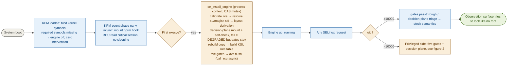
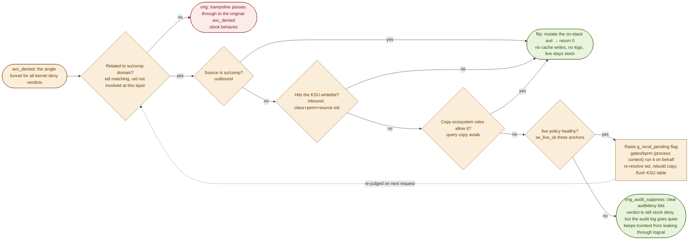

# SELinux_hide_Ind (KPM)
[English](README.md)  |  [简体中文](README_ZH.md)  |

A SELinux-hiding KPM (kernel patch module) for the KernelPatch / APatch ecosystem~

The idea is to leave the stock policy alone as much as possible: policy modifications coming from the ecosystem get hijacked into a kernel-side copy, so the stock policy (live) stays untouched; requests from normal apps are passed straight through to the kernel's native answer, while root/system/shell requests get answered by the copy

The hope is that unprivileged detectors will have a harder time spotting differences through the common timing / semantic detection paths (no guarantee against every detection method out there though)

> This project is mostly a DEMO at this stage, still slowly being worked on~
> Most of the code is vibe-coded, quality is meh — on some devices it may not take effect, or the device may not boot at all, make sure you have a way to unbrick before playing
> Thick skin required, no flames please — issues and PRs are more than welcome qwq

## 1. Design semantics

| Term            | Meaning                                                                                                                                                    |
| --------------- | ---------------------------------------------------------------------------------------------------------------------------------------------------------- |
| live            | The stock policy, the real policy currently managed by the kernel. Kept as close to stock as possible, the engine in principle never writes into it (the "three-piece set" was removed long ago) |
| copy            | A kernel-built copy of live (`policydb_read` builds all derived tables natively) + ecosystem rules + engine stamping; the answer body for privileged queries |
| stamping        | comp domain → attribute × all classes × all perms + inbound six-class whitelist + permissive bit, written into the copy only                               |
| module rules    | In principle never enter live. APatch-ecosystem writes to `/sys/fs/selinux/load` get absorbed into the copy by the gate; KSU-ecosystem batch rules go through supercall / control plane into the copy |
| comp domain     | The runtime domain of ecosystem components: KP ecosystem = `u:r:magisk:s0`, older ecosystems (no magisk type) = `u:r:su:s0`                                 |
| unprivileged (uid≥10000) | Normal app domains. Never reach the engine: gates pass through to the kernel original, the decision plane triages with one integer compare and passes through — stock semantics |
| privileged (uid<10000)  | root/system/shell. Query side (selinuxfs) gets intercepted by the gates and answered from the copy; enforcement side (kernel deny) is judged by the decision plane |
| decision plane  | A patch sitting on `avc_denied` (the single funnel for every kernel deny); handles su/comp-related requests itself, passes everything else through         |
| flip            | Decision-plane grant: mutate the on-stack avd then return 0 — no avc cache writes, no audit logs, live stays stock                                        |
| orig            | Pass-through: backup trampoline → KP replace (if present) → the original `avc_denied` = stock behavior                                                     |
| orig_audit_suppress | The inbound-deny failure path: clear the auditdeny bits of the on-stack avd before passing through (dontaudit semantics) — the verdict is still stock deny, only the audit log goes quiet, so `tcontext` doesn't sneak out through logcat |

## 2. Overall architecture (14 files)

| File          | Role                                                                                                                        |
| ------------- | --------------------------------------------------------------------------------------------------------------------------- |
| sehide_main.c | Module entry / assembly order / control plane (ctl subcommands, sepolicy batch entry)                                       |
| se_symbol.c   | Three-stage symbol resolution chain (L1 kallsyms → LTO suffix enumeration → KP full-table enumeration) + symbol binding table |
| se_layout.c   | live policydb calibration and structure derivation (probe / reverse-decode / shape scan, three tiers)                        |
| se_policydb.c | Rule primitives (avtab/ebitmap writes), copy lifecycle (build/retire-swap), blob absorption, mirror                         |
| se_render.c   | Three render paths (ctx→sid, av evaluation, sid→ctx) self-implemented on the copy side + install self-check                  |
| se_decision.c | Decision plane: avc_denied patch mount/unmount, KSU rule set, copy-funnel queries                                           |
| se_gate.c     | Query gates (/access, /context) + write gate (/load, async thread) + /policy read gate                                      |
| se_status.c   | /sys/fs/selinux/status freeze gate (unprivileged callers see the stock snapshot)                                            |
| se_bprm.c     | exec hook (first-touch install trigger + pure pass-through + comp domain switching)                                         |
| se_recal.c    | Passive fingerprint self-healing (live three anchors → light/full recalibration) + flag-and-delegate mechanism              |
| se_shadow.c   | mkpms-style page-split shadow pages (hook channel for MKP write-protected devices)                                          |
| se_rules.c    | KSU sepolicy batch wire format (isomorphic to KSU)                                                                          |
| se_util.c     | Formatting / endianness / memory / string base layer                                                                        |
| sehide.h      | Shared header: symbol table, static shape table, global state                                                               |

## 3. Install timeline (figure 1)



Key points:

1. **Install on first-touch exec**: when the KPM is loaded at pre-kernel-init, the SELinux policy hasn't been read yet (`security_read_policy` always returns -EINVAL on an uninitialized state), so this step only binds symbols; the engine body waits for the first exec after the policy is ready (real process context, sleeping allowed, `g_recal_busy` CAS mutex)
2. **Decision-plane failure = DEGRADED**: gates are still installed — intercepting ecosystem injection is a hard requirement for a clean live (if the decision plane fails to mount and the gates are missing too, LSP/Magisk injections go straight into live naked); a missing flip (su functionality gone) gets spelled out in the install self-check log
3. **Careful**: after install, avc flushing may only go through `se_avc_flush_after_recal()` (call_rcu async); calling `avc_ss_reset` directly will wait for a grace period inside the RCU section → panic / boot hang, don't step on that

## 4. The five query gates (privileged vs unprivileged split)

| Gate        | Privileged (uid<10000)                                                                                          | Unprivileged (uid≥10000)                                        | Failure path                                                                                                                              |
| ----------- | --------------------------------------------------------------------------------------------------------------- | --------------------------------------------------------------- | -------------------------------------------------------------------------- |
| /access write | Evaluated on the copy, answered in the kernel selinuxfs six-field format                                        | fallback → kernel original `sel_write_access` (live evaluation) | any failure falls back to the original; types missing from the snapshot return the stock-style EINVAL (never falls back to live, so the validity oracle can't ask it out) |
| /context write | Copy-normalized answer (note: MLS rendering defect unfixed, this gate actually always falls back, output = original = stock, harmless) | same as above                                                   | same as above                                                              |
| /load write | Absorbed into the copy asynchronously: enqueue and return (~1ms), the load thread does policydb_read + stamping + generation swap (holding `g_recal_busy` throughout) | passthrough to the kernel original (apps are already denied writes by the stock policy) | parse/class-count validation failure → **drop + fake success** (return 0). Must not return an error here, otherwise apd exits silently and zygisk dies entirely |
| /policy read | Serve the mirror directly (= stock + all ecosystem rules, serialized before stamping — apd's "read current → add rules → write back" chained accumulation depends on it) | the original open gets denied by avc already, zero intervention | during a generation swap, failing to grab the `g_recal_busy` CAS → fall back to the stock snapshot; plm location failure → stock snapshot |
| /status read | Real value passes through                                                                                       | frozen stock snapshot (policyload=1, true enforcing) — insurance for when kernel reloads push policyload up | -                                                                           |

Gate error paths copy the stock behavior as closely as possible (errno / return values), so errno-fingerprint-style detection becomes less practical

## 5. Decision plane (enforcement side; figure 2 shows the current semantics)



## 6. Build

- **CI**: pushing changes inside the `SELinux_hide_Ind/` directory to main triggers an automatic build, the artifact lands in the Actions artifacts (`SELinux_hide_Ind-kpm`)~
- **Locally**:
  ```sh
  export TARGET_COMPILE=aarch64-linux-gnu-
  export KP_DIR=/path/to/KernelPatch
  cd SELinux_hide_Ind && make
  ```

Flashing works by embedding into the boot image (kptools -m), remember to keep a boot image that can unbrick your device before you start

## Reference projects

- [KernelSU](https://github.com/tiann/KernelSU): SELinux policy deep-copy and renderer
- [KernelPatch](https://github.com/bmax121/KernelPatch/): base framework and magic-number computation
- [SELinux_hook](https://github.com/Admirepowered/selinux_hook): related KPM implementation reference

## License

AGPL v3
