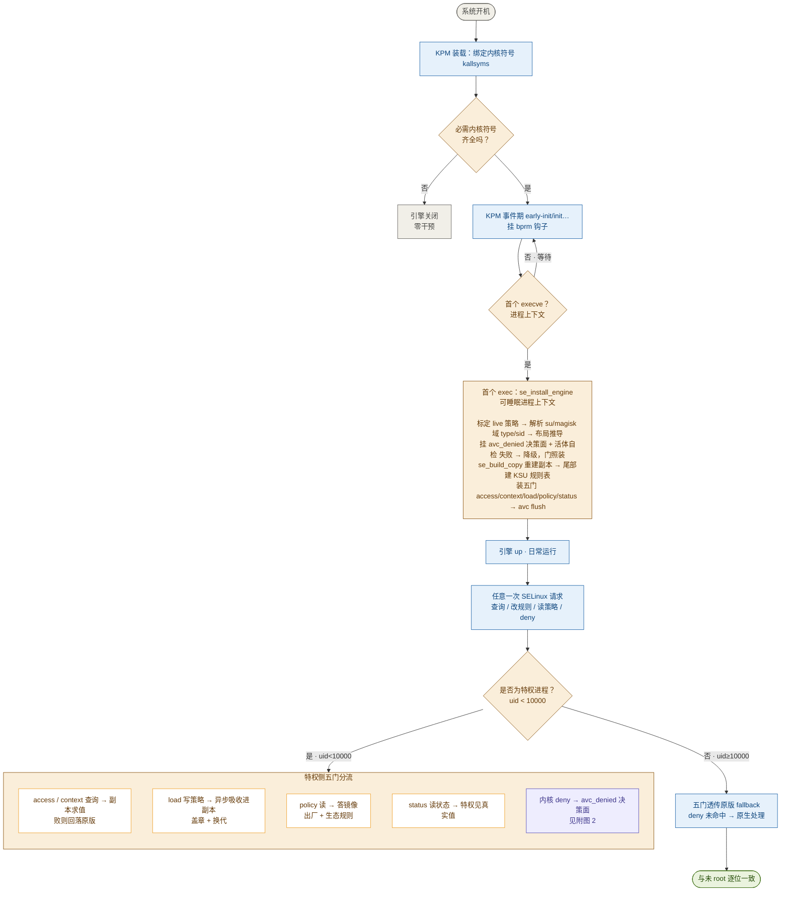
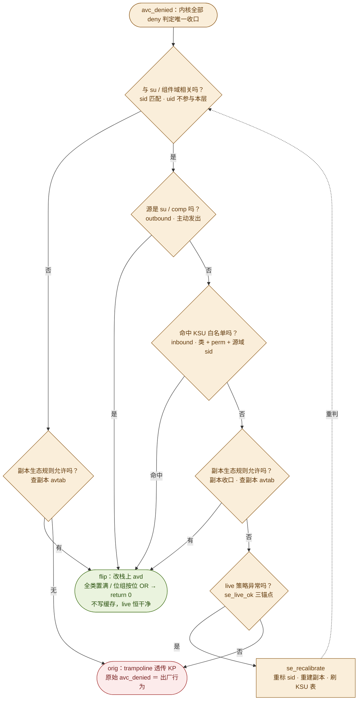

# SELinux_hide_From_LunSU (KPM)

实现方向是让出厂策略不被修改。劫持所有对出厂策略的修改到备份的策略中，也就是策略恒定与出厂相同，备份策略含模块规则等
非特权就直接透传到出厂策略内核原生作答，特权信任进程就是直接到我们的副本进行作答
理论这样非特权检测器就几乎很难做到时序检测和语义检测
当前项目仅作为一个DEMO参考，正在努力研究喵

大部分为vibe的代码，代码质量一般，在某些设备会产生兼容性问题，可能是不生效也可能会导致设备无法启动，测试时需要保证有救砖的能力
初创新项目，不稳定，玻璃心不喜勿喷qwq，大佬们可以提建议

## 设计语义

| 词汇 | 含义 |
|---|---|
| live | 出厂策略 |
| 副本 | live 的内核构建拷贝 + 其他注入规则，特权查询的答题主 |
| 模块规则 | 永不进 live；/load 写入被门吸收，模块自身的批规则走 KPM 控制面进副本 |
| 非特权（uid≥10000） | 到不了引擎：出厂 avc 权限检查（compute_av 等）天然挡死，透传=出厂答案 |
| 特权（uid<10000） | /access、/context 由门截住，从副本应答；渲染失败 fail-open 回落内核原版 |

## 实现路径（流程图）
### 图 1：KPM 总决策流程图

### 图 2：avc_denied 决策面判定树

## 参考技术项目
[KernelSU](https://github.com/tiann/KernelSU):SELinux策略深度拷贝与渲染器

[KernelPatch](https://github.com/bmax121/KernelPatch/):基础框架与魔数计算

