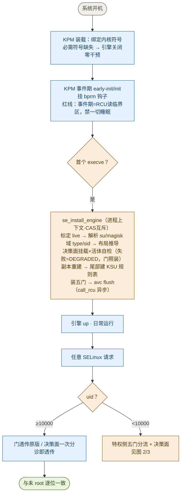
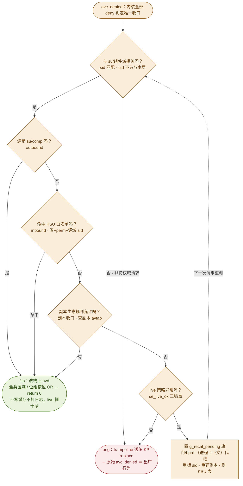

# SELinux_hide_From_LunSU (KPM) 

实现方向是让出厂策略不被修改。劫持所有对出厂策略的修改到备份的策略中，也就是策略恒定与出厂相同，备份策略含模块规则等

非特权就直接透传到出厂策略内核原生作答，特权信任进程就是直接到我们的副本进行作答

理论这样非特权检测器就几乎很难做到时序检测和语义检测

当前项目仅作为一个DEMO参考，正在努力研究喵

大部分为vibe的代码，代码质量一般，在某些设备会产生兼容性问题，可能是不生效也可能会导致设备无法启动，测试时需要保证有救砖的能力

初创新项目，不稳定，玻璃心不喜勿喷qwq，大佬们可以提提建议

## 一、设计语义

| 词汇             | 含义                                                                                |
| -------------- | --------------------------------------------------------------------------------- |
| live           | 出厂策略，内核当前管理的实时策略本体。恒与出厂一致；引擎从不写入（连三件套也已于 1.0.2 时代删除）                              |
| 副本             | live 的内核构建拷贝（`policydb_read` 由内核自建全部派生表）+ 生态规则 + 引擎盖章；特权查询的答主体                    |
| 盖章             | 组件域 → attribute×全类全权 + inbound 六类白名单 + permissive 位，只写进副本                         |
| 模块规则           | 永不进 live。APatch 生态的 `/sys/fs/selinux/load` 写入被门吸收进副本；KSU 生态的批规则走 supercall/控制面进副本 |
| 组件域（comp）      | 生态组件的运行域：KP 生态 = `u:r:magisk:s0`，旧生态（无 magisk 类型）= `u:r:su:s0`                    |
| 非特权（uid≥10000） | 正常 app 域。到不了引擎：门透传内核原版、决策面一次整数比较即透传——出厂语义                                         |
| 特权（uid<10000）  | root/system/shell。问侧（selinuxfs）被门截住从副本应答；做侧（内核 deny）由决策面判定                        |
| 决策面            | 挂在 `avc_denied`（内核 deny 唯一收口）上的补丁；只对 su/comp 相关请求自处理，其余透传                         |
| flip           | 决策面放行：改栈上 avd 后 return 0——不写 avc 缓存、不打 audit 日志，live 恒干净                          |
| orig           | 透传：backup trampoline → KP replace（若有）→ 原始 `avc_denied` ＝ 出厂行为                     |

## 二、总体架构（14 文件分层）

| 文件            | 职责                                                          |
| ------------- | ----------------------------------------------------------- |
| sehide_main.c | 模块入口/装配顺序/控制面（ctl 子命令、sepolicy 批处理入口）                       |
| se_symbol.c   | 三级符号解析链（L1 kallsyms → LTO 后缀枚举 → KP 全表按名枚举）+ 符号绑定表          |
| se_layout.c   | live policydb 标定与结构推导（探针/反解/形态扫描三级）                         |
| se_policydb.c | 规则原语（avtab/ebitmap 写入）、副本生命周期（build/retire-swap）、blob 吸收、镜像 |
| se_render.c   | 渲染三路（ctx→sid、av 求值、sid→ctx）副本侧自实现 + 装机自检                    |
| se_decision.c | 决策面：avc_denied 补丁挂载/卸载、KSU 规则集、副本收口查询                       |
| se_gate.c     | 问门（/access、/context）+ 写门（/load，异步线程）+ /policy 读门            |
| se_status.c   | /sys/fs/selinux/status 冻结门（非特权见出厂快照）                        |
| se_bprm.c     | exec 钩子（首触安装触发器 + 纯透传 + 组件域切轨）                              |
| se_recal.c    | 被动指纹自愈（live 三锚点 → light/full 重标定）+ 置旗代跑机制                   |
| se_shadow.c   | mkpms 式页分裂影子页（MKP 写保护机型的 hook 通道）                           |
| se_rules.c    | KSU sepolicy 批处理 wire format（与 KSU 同构）                      |
| se_util.c     | 格式化/字节序/内存/字符串底座                                            |
| sehide.h      | 共享头：符号表、静态形状表、全局状态                                          |

## 三、装机时序（图 1）

要点：

1. **安装挂首触 exec**：KPM 装载于 pre-kernel-init 时 SELinux 策略尚未读入（`security_read_policy` 对未初始化 state 恒 -EINVAL），所以只绑符号；引擎主体延到策略就绪后的第一个 exec（真进程上下文，可睡眠，`g_recal_busy` CAS 互斥）。
2. **决策面失败 = 降级（DEGRADED）**：门照装——拦生态注入是 live 干净的硬需求（决策面挂载失败时若门也缺席，LSP/Magisk 注入裸奔落 live，非特权 oracle 全可见）；翻转缺失（su 功能缺）由装机自检日志显性化。
3. **红线**：装机后的 avc 冲刷只允许 `se_avc_flush_after_recal()`（call_rcu 异步）；直调 `avc_ss_reset` 会在 RCU 段自等 grace → panic 卡死。

## 四、问侧五门（特权 vs 非特权分流）

| 门          | 特权（uid<10000）                                                        | 非特权（uid≥10000）                                            | 失败路径                                                               |
| ---------- | -------------------------------------------------------------------- | --------------------------------------------------------- | ------------------------------------------------------------------ |
| /access 写  | 副本求值，按内核 selinuxfs 六字段格式应答                                           | fallback → 内核原版 `sel_write_access`（live 求值）               | 任何一步失败回落原版；快照查不到的类型返回出厂同款 EINVAL（不回落 live——validity oracle 判干净的关键） |
| /context 写 | 副本规范化应答（注：MLS 渲染缺陷未修，本门实际恒 fallback，输出=原版=stock，无害）                  | 同上                                                        | 同上                                                                 |
| /load 写    | 异步吸收进副本：入队即返回（~1ms），load 线程做 policydb_read+盖章+换代（全程持 `g_recal_busy`） | passthrough 内核原版（app 本就被出厂策略拒写）                           | 解析/类数校验失败 → **丢弃+假成功**（返回 0）。红线：reject 返回会让 apd 静默退出、zygisk 全灭     |
| /policy 读  | 直供镜像（=出厂+全部生态规则，盖章前序列化存档——apd"读现行→加规则→写回"链式累积依赖）                     | 原版 open 即被 avc 拒，零干预                                      | 换代窗口期 CAS 抢不到 `g_recal_busy` → 回落出厂快照；plm 定位失败 → 出厂快照              |
| /status 读  | 真实值透传                                                                | 冻结的出厂快照（policyload=1、真 enforcing）——内核重载推高 policyload 时的保险 | -                                                                  |

门的错误路径全部与出厂逐位对齐（errno/返回值），这是 errno 指纹类检测不成立的基础。

## 五、决策面（做侧判定，图 2 为 1.1.0 现行语义）

## 参考技术项目

- [KernelSU](https://github.com/tiann/KernelSU)：SELinux 策略深度拷贝与渲染器
- [KernelPatch](https://github.com/bmax121/KernelPatch/)：基础框架与魔数计算
- [SELinux_hook](https://github.com/Admirepowered/selinux_hook)：相关KPM实现参考
