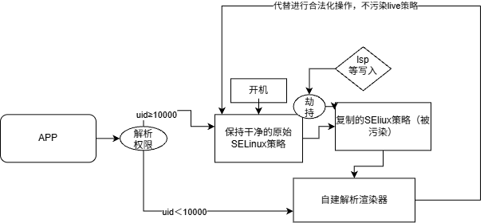

# SELinux_hide_From_LunSU (KPM)

大部分为vibe的代码，代码质量一般，在某些设备会产生兼容性问题，可能是不生效也可能会导致设备无法启动，测试时需要保证有救砖的能力
初创新项目，不稳定，玻璃心不喜勿喷qwq，大佬们可以提建议

## 设计语义

| 词汇 | 含义 |
|---|---|
| live | 出厂策略 + su 三件套（inbound 规则、permissive 位、role 条件位）——仅此而已 |
| 副本 | live 的内核构建拷贝 + su 盖章（全类全权），特权查询的答题主 |
| 模块规则 | 永不进 live；/load 写入被门吸收（blob 全丢弃，假成功），模块自身的批规则走 KPM 控制面进副本 |
| 非特权（uid≥10000） | 到不了引擎：出厂 avc 权限检查（compute_av 等）天然挡死，透传=出厂答案 |
| 特权（uid<10000） | /access、/context 由门截住，从副本应答；渲染失败 fail-open 回落内核原版 |
| 组件进域 | uid==0 且 exec 路径在 /data/adb 下 → exec 钩子把新进程域写为 su（出厂类型） |

## 项目方法思路


## 实现路径（按数据流）

```
boot ──> KP event(post-fs-data) ──> 延迟安装（sehide_main.c）
         │
         ├─ 符号解析 se_symbol.c：三级链
         │    L1 kallsyms_lookup_name(KP 填充) → L2 kallsyms_on_each_symbol(<5.10)
         │    → L3 KP by_suffix；static 符号依赖 CONFIG_KALLSYMS_ALL
         │
         ├─ 标定 se_layout.c：黑盒布局探测（无硬编码偏移）
         │    se_probe 在模拟布局上定位 permissive_map/te_avtab/len/v2n/v2s，
         │    再用真实内存验证反推 policydb 基址；cred blob 偏移、sidtab、
         │    selinux_state container 同法（4.19 直读 / 5.1+ selinux_cred 偏移）
         │
         ├─ live 写入 se_policydb.c：se_apply_trio()
         │    inbound 24 条（avtab nel 差值计量）+ permissive 位（幂等预查）
         │    + role 位；写入即扩 policydb.len（每 avtab 条 12B、每 ebitmap
         │    新窗口 12B）——6.0+ 防读 /policy -EINVAL，≤5.19 防 vmalloc 越界写
         │
         ├─ 门 se_gate.c：fops 数据槽替换（fp_hook + 回读验证）
         │    /load（sel_load_ops）：uid0 blob 全丢弃，live 不真重载
         │    /access /context（write_op[] 槽，按值扫描非下标）：uid<10000
         │      答副本，渲染失败 fail-open；-22=出厂 EINVAL 同款
         │
         ├─ 切域 se_bprm.c：bprm 钩子（≤6.11 hook_heads 数据槽 / 6.12+ 影子页，
         │    扫描失败自动降级）；orig 后写 cred（幂等），无内核指令写入
         │
         ├─ 副本 se_policydb.c：内核 policydb_read 自建（手工构造
         │    policy_file{data,len}，布局全版本恒定），换代即销毁重建
         │
         └─ 自愈 se_recal.c：live 指纹三锚（container/len/vers）
              4.19 原地 memcpy / 6.1+ RCU 指针替换双路径；
              失配 → 重标定 → 重写三件套 + 副本换代 + avc_ss_reset 补刷
              （仅进程上下文调用，禁 KP event RCU 临界区——v44 教训）
```

## 构建 / 部署

```
# WSL 内，aarch64 交叉编译
make clean && make TARGET_COMPILE=aarch64-linux-gnu- KP_DIR=../KernelPatch
# 产物：SELinux_hide_From_LunSU.kpm → kptools -M 嵌入 boot 镜像
```

验证判据（dmesg）：`calib ok` → `live trio ... len+NB` → `engine up` → `component exec -> su domain rc=0`；异常路径有一次性诊断打印（`degraded`/`rc=-22`）。

## 文件

| 文件 | 职责 |
|---|---|
| sehide_main.c | 入口、延迟安装、feature 开关、事件回调 |
| se_symbol.c | 符号解析三级链 + 全部 p_* 绑定 |
| se_layout.c | 黑盒标定链（布局/偏移/状态结构定位） |
| se_policydb.c | live 三件套、副本构建/换代、/load 吸收 |
| se_gate.c | 三道门（load/access/context）fops 劫持与应答 |
| se_bprm.c | bprm 钩子安装（数据槽/影子页）+ 组件域切轨 |
| se_recal.c | 指纹自愈、重标定、AVC 刷新 |
| se_rules.c | inbound 规则表（对齐 LunSU apply_inbound_rules） |
| se_util.c / se_stealth.c / se_status.c | 内存读写原语 / 隐蔽辅助 / status（未启用） |
